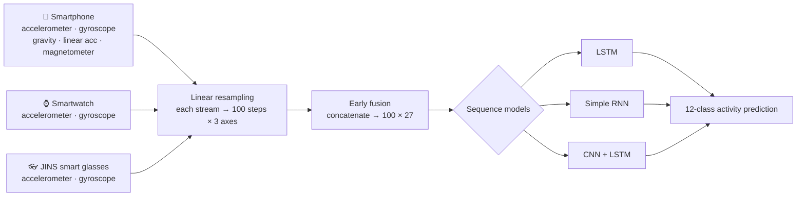

<div align="center">

<a href="#-pipeline"></a>

<br/>


-71B280?style=flat-square)


</div>

---

## 📌 Overview

People carry several sensors at once: a phone in the pocket, a watch on the wrist, and sometimes smart glasses. This project asks a simple question: **if we fuse all of those signals at the input level, how well can a sequence model recognise what a person is doing?**

Nine sensor streams from three devices are resampled to the same length and concatenated into a single **100 × 27** time series per sample (*early fusion*). Three recurrent architectures are trained on it and evaluated under two protocols: one where the same people appear in training and testing, and a harder one where the model is tested on **a person it has never seen**.

<table>
<tr>
<td align="center"><b>3</b><br/>devices</td>
<td align="center"><b>9</b><br/>sensor streams</td>
<td align="center"><b>27</b><br/>fused channels</td>
<td align="center"><b>12</b><br/>activities</td>
<td align="center"><b>436</b><br/>samples</td>
<td align="center"><b>3</b><br/>models compared</td>
</tr>
</table>

---

## ✨ Highlights

<table>
<tr>
<td width="50%"><a href="#-pipeline"></a></td>
<td width="50%"><a href="#-models"></a></td>
</tr>
<tr>
<td width="50%"><a href="#-key-results"></a></td>
<td width="50%"><a href="Report.pdf"></a></td>
</tr>
</table>

---

## 🏆 Key Results

| Model | Subject-Dependent (test) | Subject-Independent (test on unseen person) |
|:--|:--|:--|
| **LSTM** (2 layers) | `████████░░` **81.82%** 🥇 | `█░░░░░░░░░` 13.55% |
| **Simple RNN** (2 layers) | `████████░░` 78.79% | `██░░░░░░░░` **22.90%** |
| **CNN + LSTM** | `███████░░░` 69.70% | `██░░░░░░░░` 22.43% |

> [!IMPORTANT]
> **The generalization gap is the real finding.** All three models reach 70–82% when both subjects are mixed in training and testing, but drop to 13–23% when trained on one person and tested on another (random guessing over 12 classes would be ≈ 8.3%). The networks learn *how a specific person moves*, not just *what the activity is*. Closing this gap with more subjects, per-user normalisation or domain adaptation is the natural next research step.

---

## 🔄 Pipeline



---

## 📂 Dataset

**CogAge** multimodal wearable dataset, 12-activity subset. Two subjects were selected for this study, giving **436 fused samples**.

<details>
<summary><b>🎯 The 12 activities</b></summary>
<br/>

| | | | |
|:--|:--|:--|:--|
| 🙇 Bending | 📦 Bring | 🧹 Clean Floor | 🧽 Clean Surface |
| 🥤 Drink | 🙌 Dry Off Hands | 🍬 Eat Small Thing | 🛌 Lying |
| 🪑 Sitting | 🏋️ Squatting | 🧍 Standing | 🚶 Walking |

</details>

<details>
<summary><b>📡 Sensor streams (9 × 3 axes = 27 channels)</b></summary>
<br/>

| Device | Sensors | Channels |
|:--|:--|:--:|
| Smartphone | Accelerometer, Gyroscope, Gravity, Linear Accelerometer, Magnetometer | 15 |
| Smartwatch | Accelerometer, Gyroscope | 6 |
| JINS smart glasses | Accelerometer, Gyroscope | 6 |
| **Total** | **9 streams** | **27** |

Raw streams arrive at different rates (roughly 100 to 1,000 readings per event), so each stream is linearly interpolated to a fixed **100 timesteps** before fusion.

</details>

---

## 🧪 Experimental Protocols

| Protocol | Train | Validation | Test | What it measures |
|:--|:--|:--|:--|:--|
| **Subject-dependent** | 305 samples | 65 | 66 | Stratified 70 / 15 / 15 split over both subjects |
| **Subject-independent** | 177 (subject A) | 45 (subject A) | 214 (subject B) | Generalization to a completely unseen person |

---

## 🧠 Models

<details open>
<summary><b>Architectures</b></summary>
<br/>

| Model | Architecture |
|:--|:--|
| **LSTM** | Input (100 × 27) → 2 × LSTM (64 units, dropout 0.3) → last hidden state → Linear (12) |
| **Simple RNN** | Input (100 × 27) → 2 × RNN (64 units, dropout 0.3) → last hidden state → Linear (12) |
| **CNN + LSTM** | Conv1D (27 → 64, k = 3) → ReLU → MaxPool (2) → LSTM (64) → Dropout (0.3) → Linear (12) |

</details>

<details>
<summary><b>⚙️ Training configuration</b></summary>
<br/>

| Setting | Value |
|:--|:--|
| Loss | Cross-entropy |
| Optimizer | Adam, learning rate 1e-3 |
| Batch size | 32 |
| Epochs | 30 |
| Model selection | Best validation accuracy checkpoint |
| Random seed (splits) | 42 |
| Environment | Google Colab |

</details>

---

## 🚀 Getting Started

```bash
git clone https://github.com/RamzanPUCIT/pattern-recognition-early-fusion-har.git
cd pattern-recognition-early-fusion-har
pip install torch numpy pandas scikit-learn matplotlib
```

1. Open `earlyfusion.ipynb` in **Google Colab**.
2. Place the CogAge 12-activity data in Google Drive at `MyDrive/12Activities_Dataset/` (the dataset is not included in this repository).
3. Run the cells in order: data loading → resampling and fusion → subject-dependent experiments → subject-independent experiments.

---

## 🗂️ Repository Structure

```
pattern-recognition-early-fusion-har/
├── earlyfusion.ipynb   # Full pipeline: loading, fusion, training, evaluation
├── Report.pdf          # Detailed write-up of the method and results
├── assets/readme/      # Animated README graphics (SVG)
└── README.md
```

---

## 🔭 Future Work

- [ ] Leave-one-subject-out evaluation across all 8 CogAge subjects
- [ ] Per-subject normalisation and domain adaptation to close the generalization gap
- [ ] Compare early fusion with late (decision-level) fusion
- [ ] Transformer / temporal-convolution baselines
- [ ] Extend the same evaluation protocol to contactless sensing (e.g. WiFi CSI)

---

## 👨‍💻 Author

**Muhammad Ramzan** · M.Phil Artificial Intelligence, PUCIT (University of the Punjab), Lahore

[](https://linkedin.com/in/ramzan-ai)
[](https://github.com/RamzanPUCIT)
[](mailto:founders786@gmail.com)

<div align="center">

⭐ **If this project helped you, consider giving it a star!** ⭐


</div>
